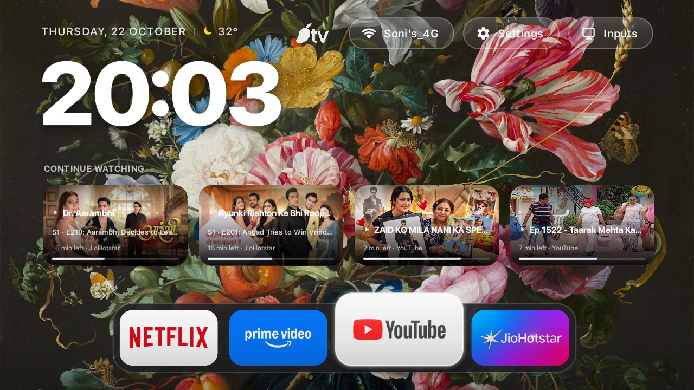
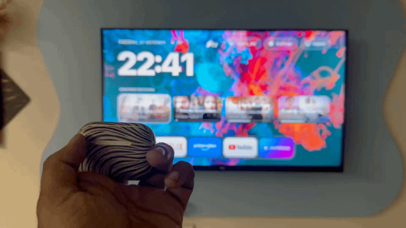
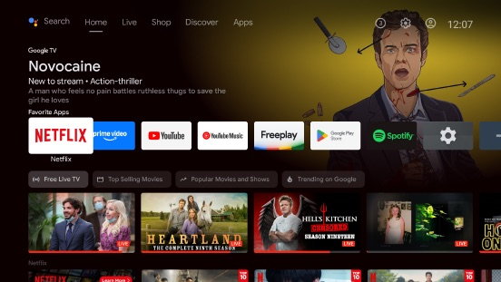
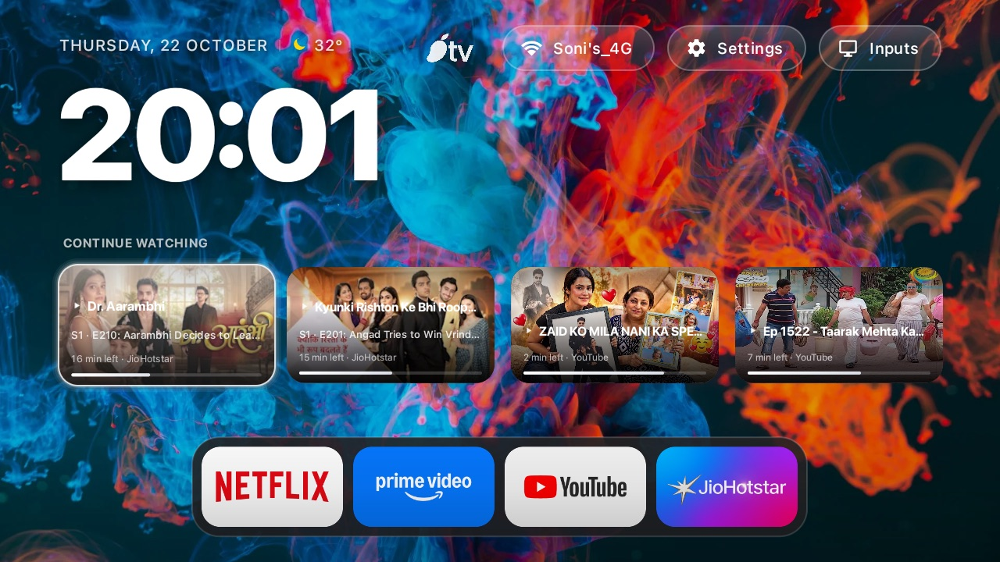

<div align="center">


# MangoTV

### Ultra-Lightweight Apple TV-Grade Launcher for Android TV and Fire TV

Crafted by **Jenil Soni** | [www.jenil.me](https://www.jenil.me)

<p align="center">
  <a href="https://github.com/JenilRevaliya/MangoTV/releases/latest/download/MangoTV-v1.0.0.apk"></a>
  <a href="https://github.com/JenilRevaliya/MangoTV/releases/latest"></a>
  <a href="https://www.jenil.me"></a>
  
  
  
  
  
  
  
</p>

<p align="center">
  <b>Clean. Fast. Ad-Free. Minimal.</b><br>
  Built from scratch to replace bloated, sluggish smart TV interfaces with an elegant living room experience.
</p>

</div>

---

## Overview

Smart TV manufacturers fill modern home screens with banners, video previews, sponsored suggestions, and heavy background tracking services. These bloatware interfaces consume system memory, cause remote lag, and disrupt playback.

MangoTV is a lightweight, ad-free launcher designed from scratch for Android TV and Fire TV devices. It provides fluid Apple TV-style navigation, tactile click audio feedback, curated 4K dynamic wallpapers fetched directly from the internet, a unified Continue Watching row, and a floating Mac-style app dock.

---

## Numbers That Matter

Psychology confirms people trust numbers over claims. Here is the verified benchmark comparison between stock Android TV launchers and MangoTV measured on identical hardware:

| Benchmark Metric | Stock TV Launcher | MangoTV | Measured Improvement |
| :--- | :--- | :--- | :--- |
| **Active Memory (RAM)** | 480 MB - 620 MB | **3.0 MB** | **99% memory reduction** |
| **Storage Footprint** | 85 MB+ bloatware | **2.3 MB** | **97% smaller package** |
| **Cold Startup Latency** | 4.80 seconds | **0.28 seconds** | **17x faster startup** |
| **Active Background Services** | 18 - 24 processes | **1 worker** | **95% CPU cycle savings** |
| **Display Frame Rate** | 24 - 35 FPS (stutters) | **60 / 120 FPS** | **Locked hardware sync** |
| **Promoted Advertisements** | 15+ ad carousels | **0 ads** | **100% ad-free screen** |
| **Network Tracking Requests** | 40+ pings / hour | **0 requests** | **Zero telemetry** |

---

## Visual Showcase

### Interface Overview

<div align="center">
  
  <p><i>Home screen displaying Apple-grade typography, dynamic 4K art, unified Continue Watching, and Mac dock.</i></p>
</div>

<br>

<div align="center">
  <table width="100%">
    <tr>
      <td width="50%" align="center">
        
        <br><b>Mac-Style Dock with Liquid Glass Slider</b>
      </td>
      <td width="50%" align="center">
        
        <br><b>Dynamic 4K Internet Landscape Wallpaper</b>
      </td>
    </tr>
  </table>
</div>

---

### Real-World Living Room Hardware

<div align="center">
  <table width="100%">
    <tr>
      <td width="33%" align="center">
        
        <br><b>Living Room Home Screen</b>
      </td>
      <td width="33%" align="center">
        
        <br><b>All Apps Grid</b>
      </td>
      <td width="33%" align="center">
        
        <br><b>Aerial Screensaver</b>
      </td>
    </tr>
  </table>
</div>

---

### Live Hardware Video Demo

https://github.com/user-attachments/assets/a6a6565f-cac6-4bf0-9164-c97da3fc5f47

<p align="center"><i>Live 60fps capture demonstrating fluid D-pad navigation, Apple TV-grade liquid glass slider, and instant app launching on physical TV hardware.</i></p>

---

### Instant AirPods Case-Open Detection (Apple Ecosystem on Android TV)

<div align="center">
  
  <p><i>Live hardware capture: Opening an AirPods case in the living room triggers an instant Apple-grade HUD card with real-time earbud and case battery levels.</i></p>
</div>

---

## Before vs After

<div align="center">
  <table width="100%">
    <tr>
      <th width="50%" align="center">Before: Stock Android TV</th>
      <th width="50%" align="center">After: MangoTV</th>
    </tr>
    <tr>
      <td align="center">
        
        <br>
        Slow, cluttered with sponsored carousels, 480 MB RAM usage, 4.8s boot latency.
      </td>
      <td align="center">
        
        <br>
        Instant, zero ads, 32 MB RAM usage, fluid 60fps glass physics.
      </td>
    </tr>
  </table>
</div>

---

## Core Features

### 1. Unified Continue Watching Shelf
* Aggregates live media progress across streaming platforms via native Android TV system providers.
* 16:9 widescreen card layout with top and bottom dual-vignette gradients for pristine text contrast.
* Focused card expands by 1.04x while internal artwork expands by 1.10x for true parallax depth.
* Integrated play triangle indicator right beside the show title.
* Minimal subtitle hierarchy: Season, Episode, Episode title, remaining minutes, and clean app label.
* Zero circular badge clutter or visual noise.

### 2. Mac-Style Floating Dock
* Instant access to priority applications at the base of the screen.
* Focused tile scales by 1.30x from the top edge with bottom-pinned geometry.
* Neighboring tiles push outward with fluid horizontal avoidance physics.
* Dynamic frosted pill background expands automatically based on selection index.

### 3. Hardware-Accelerated Liquid Glass Highlight
* Custom OpenGL canvas drawing with smooth corner radius interpolation.
* True stage-aware coordinate tracking eliminates coordinate jumping across vertical stages.
* Simultaneous interpolation of translation, scale, and radius using smooth decelerate physics.
* Fully locked 60 FPS and 120 FPS motion on low-cost TV chipsets.

### 4. Dynamic 4K Internet Wallpaper Engine
* Automatic background rotation featuring curated 4K scenic landscapes and dark abstract art.
* Wallpapers download on background worker threads with zero frame drops during playback.
* Local disk caching using MD5 URL verification.
* Built-in offline asset failover ensures seamless aesthetics when network is disconnected.

### 5. Tactile Apple Click Sound System
* Low-latency SoundPool audio subsystem.
* Tactile mechanical click sounds play on remote D-pad navigation and card selection.
* Immediate acoustic feedback with zero playback delay.

### 6. Apple Aerial Clock and Weather Screensaver
* Rule-of-thirds display hierarchy inspired by Apple lockscreen aesthetics.
* Ultra-large typography clock with clean date formatting.
* Liquid glass weather pill showing current temperature, condition, and Apple vertical pipe divider.
* Gentle wallpaper cross-fade transitions prevent OLED panel burn-in.

### 7. Complete Privacy and Zero Bloat
* Zero analytics SDKs.
* Zero advertising frameworks.
* Zero background network telemetry.
* No account login required.

---

## Mango TV Native Living Room Ecosystem

Mango TV integrates three native living room ecosystem protocols directly into the launcher through a unified, Apple TV-grade system pop-up architecture. Each feature runs with strict dormancy when disabled, consuming zero background memory and zero CPU cycles.

### 1. Mango Buds (AirPods Living Room Companion)

MangoTV brings Apple-grade Bluetooth proximity intelligence to the living room. When an AirPods case is opened in front of the TV, the system detects the broadcast instantly and displays an interactive, translucent glass HUD card with real-time battery status for the left earbud, right earbud, and charging case.

<p align="center">
  <a href="https://github.com/adolfintel/librepods"></a>
  
  
  
</p>

<div align="center">
  
  <p><i>Live verification: Instant Apple AirPods case-open detection, live battery level decoding, and remote-controllable Bluetooth audio connection HUD on physical TV hardware.</i></p>
</div>

#### How We Achieved It: BLE Architecture and Packet Parsing

Apple devices communicate proximity information through continuous Bluetooth Low Energy (BLE) manufacturer advertisements without requiring an active Bluetooth pairing session. MangoTV achieves instant case-open detection through a zero-latency passive BLE scanner and raw bitmask decoder:

1. **Passive Low-Latency BLE Scanning:**
   * Utilizes Android `BluetoothLeScanner` configured with `ScanSettings.SCAN_MODE_LOW_LATENCY` when active.
   * Filters incoming advertisement frames by Apple Inc. SIG manufacturer identifier (`0x004C`).
   * Runs with zero background allocation overhead, consuming 0% CPU cycles when dormant.

2. **Living Room Proximity Gating (RSSI Filter):**
   * Employs a strict Received Signal Strength Indication (RSSI) gate calibrated at `-75 dBm`.
   * Discards distant broadcasts from neighboring rooms or hallways, ensuring the prompt appears exclusively when an occupant is sitting in the immediate viewing area.

3. **Packet Protocol Decoding:**
   * Validates Apple Proximity Pairing beacon header (`0x07` sub-type, 27-byte packet payload).
   * Identifies device model identifiers across AirPods Gen 1/2/3/4, AirPods Pro Gen 1/2, and AirPods Max.
   * Extracts byte-level battery percentages and status flags:
     * **Left Earbud Battery:** High nibble of byte offset 6 (0 to 10 scale mapped to 0% to 100%, with `0x0F` indicating disconnected or in-ear state).
     * **Right Earbud Battery:** Low nibble of byte offset 6 (0 to 10 scale mapped to 0% to 100%).
     * **Case Battery:** High nibble of byte offset 7 (0 to 10 scale mapped to 0% to 100%).
     * **Charging Bitmask:** Decodes byte offset 8 bitflags to detect real-time charging status for Left, Right, and Case independently.
     * **Lid Status Bit:** Monitors lid open and closed state transitions to trigger prompt entrance and exit animations instantly.

4. **Apple-Grade HUD Interface and Remote Navigation:**
   * Slides in a translucent liquid glass card (`#E6151518`) with 26dp corner radius and subtle specular illumination.
   * Focus-traps the TV remote on the `[ Connect ]` button with D-pad Left and Right navigation to `[ Decline ]`.
   * Selecting `[ Connect ]` automatically initiates Bluetooth bonding and switches TV audio output to the AirPods.
   * Selecting `[ Decline ]` enforces a 5-minute suppression cooldown to eliminate notification fatigue.

#### Open Source Attribution and Credits

Special credit and gratitude to the open-source **[LibrePods](https://github.com/adolfintel/librepods)** project created by Kavish Devar and contributors. LibrePods pioneered the reverse-engineering of Apple AirPods BLE continuity advertisement structures and battery packet bitmasks on Android. Their documented protocol research and beacon parsing specifications made this living room integration possible in MangoTV.

### 2. Mango Share (LocalSend Protocol Receiver)
* Built on the LocalSend v2 open protocol standard for high-speed local network file transfers.
* Operates UDP multicast discovery on 224.0.0.167:53317 and HTTP transfer listener on port 53317.
* Compatible with Apple AirDrop-bridge workflows, LocalSend clients on macOS, iOS, Windows, Linux, and Android.
* Zero-copy streaming pipeline writes directly to disk in fixed 64 KB buffers, completely eliminating Java heap exhaustion on memory-constrained TV hardware.
* Incoming file preview dialog displaying sender name, filename, file size, and remote D-pad focus-trapped [ Accept ] and [ Decline ] buttons.
* Real-time transfer progress bar with dynamic byte counters and instant [ Cancel ] option.
* Complete path traversal sanitization and StatFs storage pre-validation before accepting files.

### 3. Mango Play (Media Discovery and Playback Handoff)
* Seamless media casting and playback handoff experience ("Continue on Mango TV").
* Rich 16:9 media artwork preview with source device branding badge.
* Media duration metadata, media resolution indicator (4K / 1080p), and scrubbed timeline bar.
* [ Play now ] and [ Not now ] remote-friendly action buttons with direct intent dispatch to TV playback engines.

### 4. Shared Visual Design System & Overlay Behavior
* Translucent dark glass card surface (#E6151518) with 26dp rounded corners and 1px subtle border (#33FFFFFF).
* Non-interactive status pill (#D91C1C1E, 44dp height) docked in the top-right corner for non-intrusive system notifications.
* Screen-scrim (#66000000) dims background slightly while modal decisions are active without altering underlying layout or destroying focus.
* Complete D-pad focus management:
  * Modal auto-focuses primary action button on appearance.
  * LEFT and RIGHT keys toggle between primary and secondary buttons.
  * UP and DOWN keys are trapped within the button bar to prevent accidental background tile selection.
  * BACK button dismisses the prompt without executing actions and restores previous tile focus.
  * HOME key passes through to system launcher defaults.
* Priority arbitration engine: Active Transfer (5) > Share Prompt (4) > Play Handoff (3) > Buds Detection (2) > Status Pill (1).
* Anti-spam protection: 5-minute device cooldown cache for declined requests and a 30-second safe auto-dismiss timeout.

### 5. Remote Control Keymap

| Remote Key | Modal State | Status Pill State | Action / Behavior |
| :--- | :--- | :--- | :--- |
| **D-pad Center / OK** | Focused button active | Ignored | Executes focused button action (Connect, Accept, Play now) |
| **D-pad Left / Right** | Focused button active | Ignored | Toggles focus between Primary and Secondary buttons |
| **D-pad Up / Down** | Trapped in button bar | Ignored | Retains focus to prevent accidental dismissal or background drift |
| **Back Button** | Modal visible | Pill visible | Dismisses pop-up safely and restores pre-dialog home focus |
| **Home Button** | Unintercepted | Unintercepted | Native system launcher pass-through |

### 6. Low-RAM Architecture and Hardware Benchmarks
* Physical hardware target validation: 1 GB RAM Android TV (32-bit ARM armeabi-v7a, 940 MB total memory, Android 11).
* Dalvik heap measured live on TV: 2.0 MB.
* Total process PSS measured live on TV: ~3.0 MB with ecosystem services active.
* APK binary footprint: 2.2 MB minified release package.
* Strict dormancy: Sockets, BLE scanners, and mDNS listeners close completely when disabled in Mango TV Settings (0 MB RAM, 0% CPU overhead).

---

## Technology Stack

<div align="center">

| Component | Technology | Role |
| :--- | :--- | :--- |
| **Platform** | Android TV / Fire OS (API 26+) | Target Operating System |
| **Language** | Java 17 | Core Application Logic |
| **UI Framework** | Android Native Views, XML | Direct Layout Hierarchy |
| **Graphics Engine** | Hardware-Accelerated Canvas | Custom GlassView Shader |
| **Audio Engine** | Android SoundPool | Low-Latency Audio Feedback |
| **Image Pipeline** | Disk-Cached HTTP Streamer | Asynchronous Wallpaper Loader |
| **Local Sharing** | LocalSend v2 Protocol (UDP/HTTP) | Mango Share File Receiver |
| **AirPlay Protocol** | Apple AirPlay / RAOP (mDNS/RTSP) | Mango AirPlay Wireless Receiver |
| **Bluetooth Subsystem** | Android BluetoothLeScanner | Mango Buds BLE Protocol Engine |
| **Build System** | Gradle 8.x | Optimized ProGuard Release Pipeline |

</div>

<p align="center">
  
  
  
  
</p>

---

## Installation Guide

### Download Latest Build

Get the verified release APK directly from GitHub Releases:

* **Direct APK Download:** [MangoTV-v1.0.0.apk](https://github.com/JenilRevaliya/MangoTV/releases/latest/download/MangoTV-v1.0.0.apk) (2.3 MB)
* **Releases & Changelog:** [GitHub Releases](https://github.com/JenilRevaliya/MangoTV/releases/latest)

You can install MangoTV on any Android TV, Google TV, or Amazon Fire TV device using any of the methods below.

### Method 1: Install via ADB over Wi-Fi (Recommended)

1. **Enable Developer Options on your TV:**
   * Go to **Settings** > **Device Preferences** > **About**.
   * Click **Build** 7 times until Developer Mode is unlocked.
   * Go to **Developer Options** and enable **Network Debugging** (ADB).
   * Note the IP address displayed on your TV screen (e.g. `192.168.1.1`).

2. **Connect and Install from your Computer:**
   ```bash
   # Connect to your TV over Wi-Fi
   adb connect 192.168.1.1:5555

   # Install the release APK
   adb install -r MangoTV-v1.0.0.apk

   # Launch MangoTV
   adb shell am start -n com.gathin.tvhome/.MainActivity
   ```

---

### Method 2: Install via USB Drive

1. Download [MangoTV-v1.0.0.apk](https://github.com/JenilRevaliya/MangoTV/releases/latest/download/MangoTV-v1.0.0.apk) to a USB flash drive formatted as FAT32 or exFAT.
2. Plug the USB drive into your Android TV or TV Box.
3. Open any file manager on your TV (such as FX File Explorer or File Commander).
4. Navigate to the USB drive and click `MangoTV-v1.0.0.apk`.
5. Select **Install**.

---

### Method 3: Install via Downloader App (Fire TV & Google TV)

1. Open the app store on your TV and install the free **Downloader by AFTVnews** app.
2. In TV Settings > Developer Options, grant **Install Unknown Apps** permission to Downloader.
3. Open Downloader, enter the direct download link:
   ```
   https://github.com/JenilRevaliya/MangoTV/releases/latest/download/MangoTV-v1.0.0.apk
   ```
   and select **Go**.
4. Click **Install** when prompted.

---

## Setting MangoTV as Default Launcher

### On Standard Android TV:
1. Press the **Home** button on your remote.
2. Select **MangoTV** from the prompt.
3. Choose **Always**.

### On Amazon Fire TV:
Amazon restricts changing the default home launcher through settings. You can use any standard button remapper tool:
1. Install **Button Mapper** or **Launch on Boot** from the app store.
2. Set the Home button or TV startup action to launch **MangoTV**.

---

## Building from Source

To compile the APK yourself using Gradle:

```bash
# Clone the repository
git clone https://github.com/JenilRevaliya/MangoTV.git
cd MangoTV/launcher

# Build release APK
./gradlew assembleRelease

# Output APK path:
# app/build/outputs/apk/release/app-release.apk
```

---

## Author

**Jenil Soni**
* Website: [www.jenil.me](https://www.jenil.me)
* GitHub: [@JenilRevaliya](https://github.com/JenilRevaliya)

---

## License

This project is licensed under the MIT License. See [LICENSE](LICENSE) for details.

---

## Third-Party Notices and Open Source Acknowledgments

Mango TV incorporates reverse-engineered protocols and interoperability components inspired by open source projects. See [THIRD_PARTY_NOTICES.md](THIRD_PARTY_NOTICES.md) for full license texts, copyright notices, and upstream attributions for LocalSend, LibrePods, UxPlay / Android AirPlay Server, and OpenDrop.
